<p align="center">
  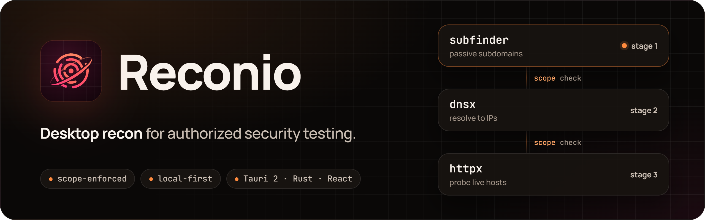
</p>

<p align="center">
  <a href="https://github.com/Madhavv13/Reconio/actions/workflows/ci.yml"></a>
  
  
  
  
  
  <a href="LICENSE"></a>
</p>

<p align="center">
  
  
  
  
  
  
</p>

<p align="center">
  <a href="#features">Features</a> ·
  <a href="#screenshots">Screenshots</a> ·
  <a href="#how-it-works">How it works</a> ·
  <a href="#getting-started">Getting started</a> ·
  <a href="#roadmap">Roadmap</a> ·
  <a href="SECURITY.md">Security</a>
</p>

---

> [!WARNING]
> **Early development.** Modules 0 and 1 of 6 are built: foundations, engagements and scope. The recon pipeline itself (Module 2) is in progress, so Reconio cannot run a scan yet. Use it only against targets you are authorized to test.

**Reconio** is a native desktop app that runs the recon chain bug bounty hunters and pentesters usually wire up by hand: **subfinder → dnsx → httpx**. It runs them per client engagement, checks scope between every stage, and keeps every result in a local database. No Docker, no WSL and no shell scripts: the tools come bundled, pinned and checksum-verified, and your target data never leaves your machine.

<p align="center">
  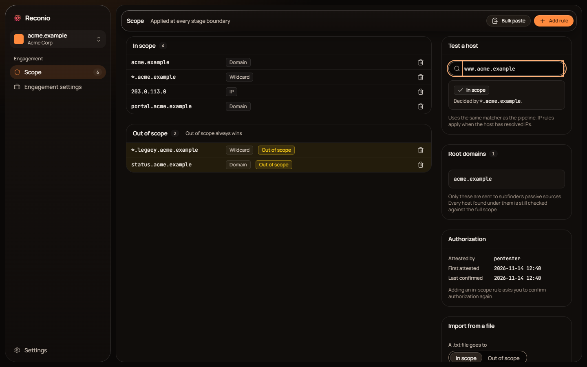
</p>

## Features

| | Feature | What it does |
|:-:|---|---|
| ✅ | **Engagements** | One folder and SQLite database per client or program. A switcher in the sidebar, the engagement name in the window title, reopens the last one used, and delete needs you to type the name. |
| ✅ | **Scope engine** | Domains, wildcards (`*.acme.example`), in-label patterns, IPs, CIDR ranges and pasted URLs, normalized to punycode (IDNA 2008 / UTS-46). **Out of scope always wins.** Pure Rust, no I/O, and the same matcher is used everywhere. |
| ✅ | **Test a host** | Type a host, URL or IP and see *In scope*, *Out of scope* or *Pending*, plus the rule that decided it. |
| ✅ | **Bulk paste and import** | Paste a program's scope or import `.txt` / `.csv` (HackerOne's `eligible_for_submission` column is understood). A live preview shows each rule's kind, invalid lines and hints, for example *"`*.legacy.x` leaves `legacy.x` itself in scope"*, with a one-click fix. |
| ✅ | **Root domains** | Works out the only names that will ever be sent to passive sources, and blocks a run whose scope can't be enumerated safely. |
| ✅ | **Authorization record** | "I am authorized to test this scope" is required to create an engagement and to add in-scope rules. Your OS user name and the time are saved with the engagement. |
| ✅ | **Bundled, verified tools** | subfinder 2.17.0, dnsx 1.3.1, httpx 1.12.0 pinned in [`tools.lock.json`](tools.lock.json) with a SHA-256 for each OS. Tools are **never** looked up on `PATH`, so the unrelated Python `httpx` can't be picked up by mistake. |
| ✅ | **Process supervisor** | The only code that starts a tool. It always adds `-duc -nc`, rejects update and proxy flags, clears proxy variables, and ties every tool to the app with a Windows Job Object, so no tool outlives Reconio. |
| ✅ | **API keys in the OS keychain** | Keys for passive sources live in Windows Credential Manager, macOS Keychain or Linux Secret Service, never in a database or log. The UI only ever sees `ghp_••••3f2a`. |
| ✅ | **Onboarding and Settings** | A 4-step first run (welcome, tool check, API keys, first engagement). Settings has API keys, tools (threads, rate limit, timeout, all validated), resolvers, performance, data, privacy and about. |
| ✅ | **Local-first** | Reconio makes no network calls of its own. Crash reports and usage statistics are opt-in and off by default. |
| ✅ | **Accessible** | Built to WCAG 2.2 AA, with keyboard paths for everything, 200% zoom and reduced motion. Every screen is checked automatically ([details](docs/ACCESSIBILITY.md)). |
| 🔜 | **Pipeline** | Chunked runs with four scope checks, stop / pause / resume, crash recovery and a run log (Module 2). |
| 🔜 | **Results** | Subdomains, resolved and live hosts in virtualized tables with a filter language and an inspector (Module 3). |
| 🔜 | **Export and command palette** | Host lists and presets for your next tool, plus a keyboard command palette (Module 4). |

## Screenshots

<table>
  <tr>
    <td width="50%">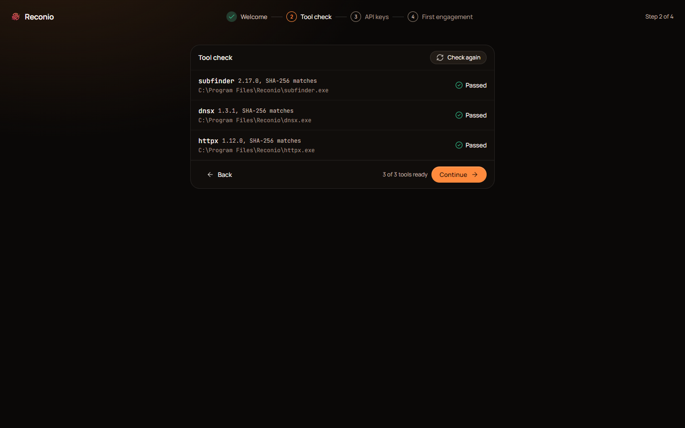<p align="center"><sub><b>Tool check.</b> Every bundled tool is verified by version and SHA-256.</sub></p></td>
    <td width="50%">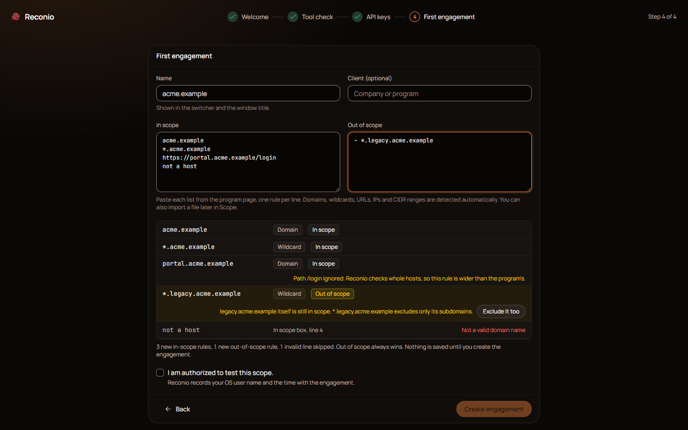<p align="center"><sub><b>First engagement.</b> Live scope preview with hints and invalid lines.</sub></p></td>
  </tr>
  <tr>
    <td width="50%">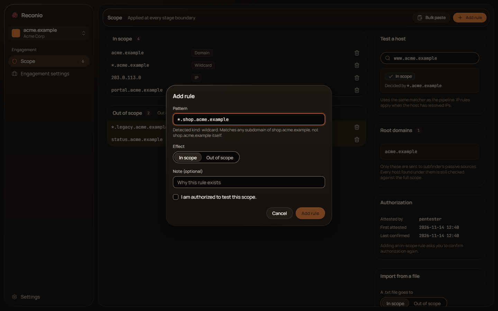<p align="center"><sub><b>Add rule.</b> The kind is detected and explained as you type.</sub></p></td>
    <td width="50%">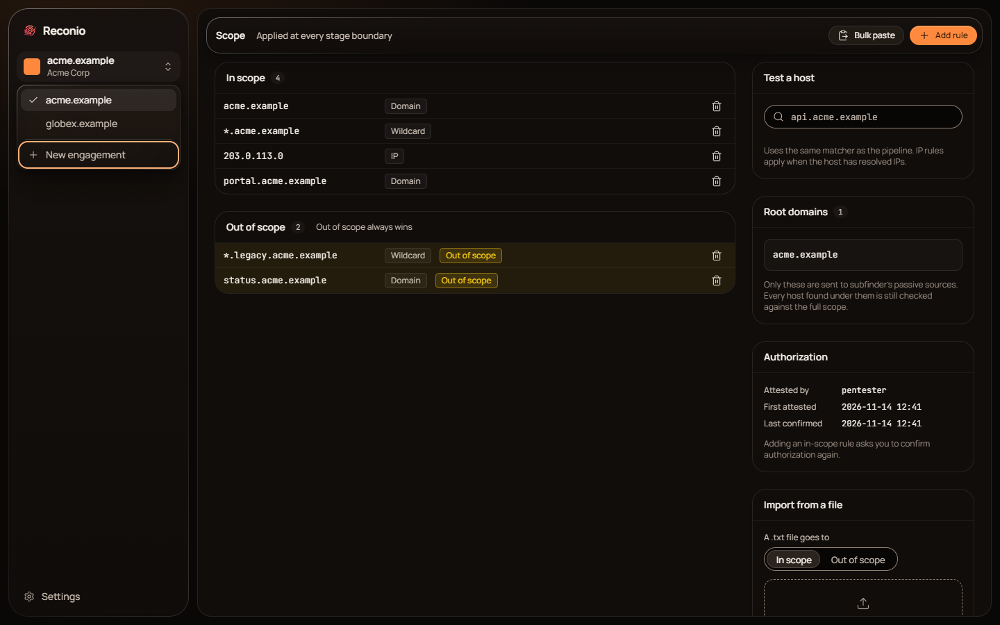<p align="center"><sub><b>Engagement switcher.</b> Each engagement keeps its own data.</sub></p></td>
  </tr>
</table>

<details>
<summary><b>More screenshots</b></summary>
<br>

| | |
|---|---|
| 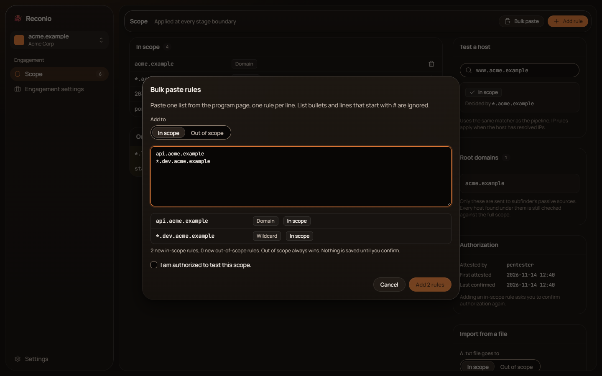 | 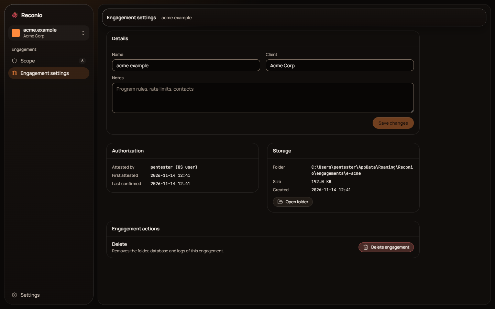 |
| **Bulk paste** with preview | **Engagement settings**, authorization and storage |
| 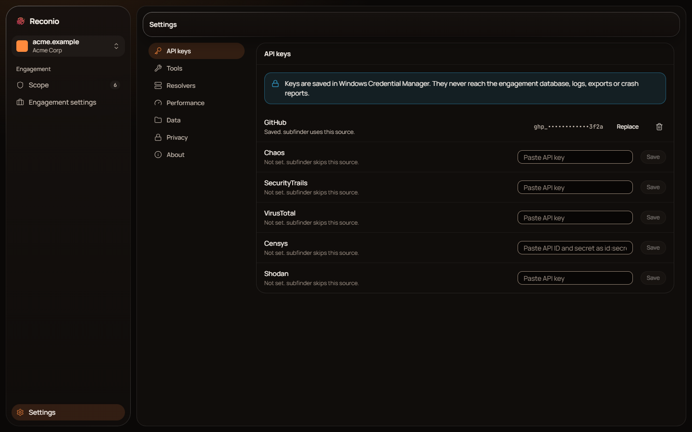 | 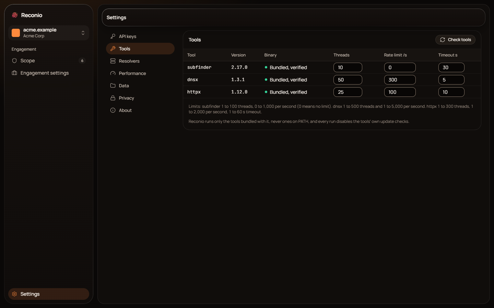 |
| **API keys**, stored in the OS keychain | **Tools**, with validated limits |

</details>

## How it works

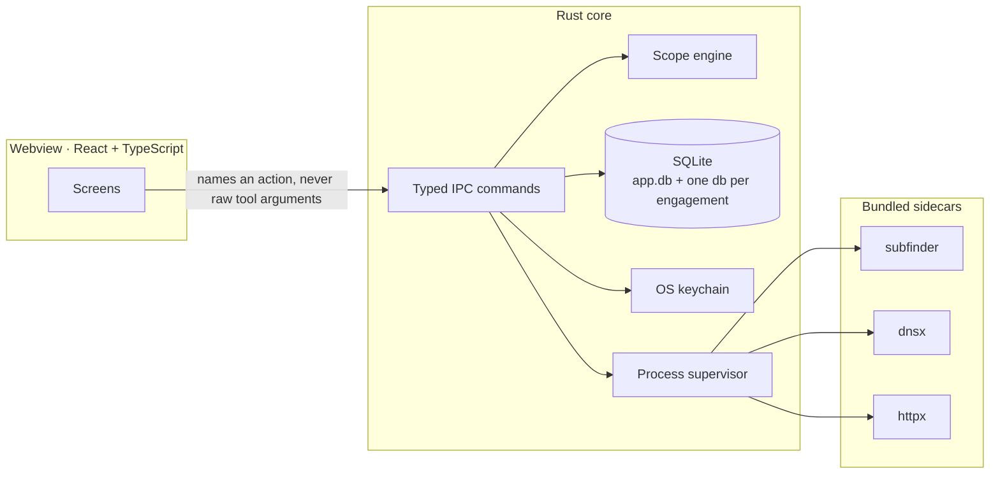

The webview can't start processes or pass tool flags. It names an action, and the Rust core builds the arguments itself. TypeScript types for every command are generated from Rust ([ts-rs](https://github.com/Aleph-Alpha/ts-rs)), so the two sides can't drift. More detail in [docs/ARCHITECTURE.md](docs/ARCHITECTURE.md).

**The pipeline (Module 2, in progress)** runs the scope engine at every stage boundary:

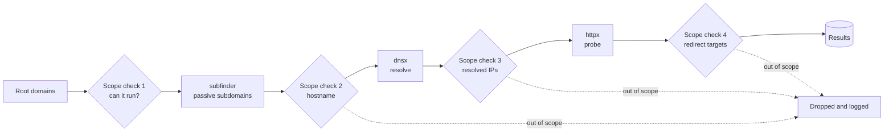

## Getting started

**Prerequisites:** Node.js 20+, Rust (stable, MSVC toolchain on Windows), the WebView2 runtime (preinstalled on Windows 11), and Microsoft Edge or Chrome for the accessibility check.

```sh
npm install
npm run fetch-tools     # downloads pinned subfinder, dnsx, httpx and verifies SHA-256 against tools.lock.json
npm run tauri dev       # first start compiles the Rust core (a few minutes)
```

A step-by-step walkthrough, from first launch to building an installer, is in **[docs/RUNNER.md](docs/RUNNER.md)**.

| Script | What it does |
|---|---|
| `npm run tauri dev` | Run the app in development |
| `npm run fetch-tools` | Download and verify the pinned tools into `src-tauri/binaries/`. Fails on any checksum mismatch |
| `npm run test:rust` | Rust tests (scope engine, supervisor, Job Object kill, storage). Also regenerates the TS bindings |
| `npm run test:a11y` | Every screen in Edge with axe-core (WCAG 2.2 AA), at 200% zoom, with keyboard paths. Must pass before a commit |
| `npm run sync-design` | Copy design tokens, components and the logo from the design system (runs before `dev` and `build`) |
| `npm run readme:assets` | Re-render the README banner and copy fresh screenshots from the accessibility run |
| `npm run tauri build` | Release build plus `.msi` and NSIS installers |

<details>
<summary><b>Project layout</b></summary>

```text
Reconio/
├─ src/                    React app
│  ├─ shell/               sidebar, screen frame, error boundary
│  ├─ screens/             one folder per screen (onboarding, scope, engagement, settings)
│  ├─ ui/                  dialog, segmented control, table wrapper, a11y helpers
│  ├─ ipc/                 thin wrappers + bindings generated from Rust
│  └─ styles/design/       design tokens and components (synced, never edited here)
├─ src-tauri/
│  ├─ src/scope/           parser, normalizer, matcher, hints, root domains (pure, no I/O)
│  ├─ src/supervisor/      the only code that starts tool processes (+ Windows Job Object)
│  ├─ src/tools/           tool registry and the tool check
│  ├─ src/db/              SQLite, WAL, forward-only migrations with backups
│  ├─ src/commands/        typed IPC commands
│  └─ tests/               scope regression suite (fixtures + proptest)
├─ scripts/                fetch-tools, sync-design, a11y check, readme assets
├─ tests/a11y/             harness: the real app against a fake Rust core
└─ tools.lock.json         pinned tool versions and SHA-256 per OS
```

</details>

## Quality gates

Every module has to pass all of these before it is committed:

- **87 Rust tests**: 81 unit tests plus the **scope regression suite**, which covers 35 real-world scope decisions, 7 paste-parsing cases and randomized property checks with [proptest](https://github.com/proptest-rs/proptest). A failure in the scope suite blocks a release.
- **Accessibility gate**: `npm run test:a11y` renders the real React app in Edge, walks every screen and dialog at 1440 × 900 and at 200% zoom, and fails on any axe-core WCAG 2.2 A/AA violation, clipped content, or a broken keyboard path.
- **CI** runs the build, the Rust tests and the accessibility gate on Windows for every push and pull request.

## Roadmap

- [x] **Module 0: Foundations.** Tauri shell, design system, pinned tools, process supervisor
- [x] **Module 1: Engagements and scope.** Storage, scope engine, Scope screen, onboarding, Settings, accessibility gate
- [ ] **Module 2: Pipeline engine.** Adapters, chunk queue, four scope checks, stop / pause / resume, crash recovery
- [ ] **Module 3: Results.** Virtualized tables, filter language, inspector
- [ ] **Module 4: Export and polish.** Exports and presets, command palette
- [ ] **Module 5: Hardening.** Benchmarks, security review, signed installers, macOS and Linux builds
- [ ] **Phase 2.** An intercepting proxy and repeater, so recon flows straight into manual testing

See the [changelog](CHANGELOG.md) for what changed in each module.

## Responsible use

Reconio is for **authorized** security testing only: bug bounty programs within their published scope, and penetration tests with written permission. You are responsible for the scope you enter. Scope enforcement helps you stay inside it, but it can't stand in for permission. To report a vulnerability in Reconio itself, see [SECURITY.md](SECURITY.md).

## Acknowledgements

Reconio bundles [subfinder](https://github.com/projectdiscovery/subfinder), [dnsx](https://github.com/projectdiscovery/dnsx) and [httpx](https://github.com/projectdiscovery/httpx) by ProjectDiscovery (MIT). Reconio is not affiliated with or endorsed by ProjectDiscovery. Built with [Tauri](https://tauri.app), [React](https://react.dev), [rusqlite](https://github.com/rusqlite/rusqlite), [Lucide](https://lucide.dev) icons (ISC), [GSAP](https://gsap.com), and the [Manrope](https://github.com/sharanda/manrope) and [JetBrains Mono](https://github.com/JetBrains/JetBrainsMono) typefaces (SIL OFL 1.1).

---

<p align="center">
  <sub>© 2026 Madhavv13. All rights reserved. Proprietary software; see <a href="LICENSE">LICENSE</a>.</sub>
</p>
