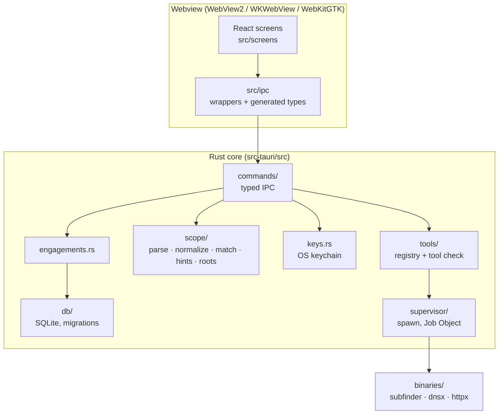

# Architecture

Reconio is a [Tauri 2](https://tauri.app) desktop app: a React + TypeScript interface in the operating system's webview, and a Rust core that owns storage, scope decisions, secrets and every tool process. The recon tools (subfinder, dnsx, httpx) are pure-Go binaries bundled next to the app as Tauri sidecars.



## Boundaries

**The webview names actions; the core builds commands.** The webview never passes raw tool arguments or paths. Each IPC command (`engagement_create`, `scope_apply`, `scope_test`, `keys_set`, `tools_status` and the rest, in [commands/](../src-tauri/src/commands)) takes typed input, and the core decides what runs. The capability file ([capabilities/default.json](../src-tauri/capabilities/default.json)) doesn't expose Tauri's shell plugin, and the content security policy in [tauri.conf.json](../src-tauri/tauri.conf.json) allows only local resources and IPC.

**Types are generated, not hand-written.** Rust structs and enums derive [ts-rs](https://github.com/Aleph-Alpha/ts-rs) bindings, which `npm run test:rust` regenerates into `src/ipc/bindings`. If a field changes in Rust, the TypeScript build fails until the UI catches up.

## Scope engine (`src-tauri/src/scope`)

Pure code with no I/O. Every scope decision in the product goes through one matcher, whether it's the scope test box, the root-domain list, and later the four pipeline checks and exports. So a host is judged the same way everywhere.

| File | Job |
|---|---|
| `normalize.rs` | One entered value → kind (domain, wildcard, pattern, IP, CIDR) and canonical form. URLs are reduced to their host, and names become lowercase punycode (IDNA 2008, UTS-46). |
| `parse.rs` | Pasted lists and `.txt` / `.csv` imports → a preview of new rules, duplicates and invalid lines. Understands bullets, comments, `!` exclusions and HackerOne's `eligible_for_submission` column. |
| `matcher.rs` | Rules indexed per effect. **Out of scope always wins.** A hostname that matches no name rule is *pending* when in-scope IP or CIDR rules exist, and is decided once its IPs are known. |
| `hints.rs` | Flags rules that don't mean what people usually expect, e.g. an in-scope `*.x` doesn't cover `x` itself, or a URL path was dropped. Each hint offers a one-rule fix. |
| `roots.rs` | Root domains to enumerate, and scope check 1: why a scope can't start a run. |

The regression suite in [tests/scope_regression.rs](../src-tauri/tests/scope_regression.rs) replays real-world scope cases from [fixtures/scope_cases.json](../src-tauri/tests/fixtures/scope_cases.json) and runs proptest property checks. A failure there blocks a release.

## Processes (`src-tauri/src/supervisor`, `src-tauri/src/tools`)

- **Tools are resolved, never searched for.** `tools::resolve_path` finds the sidecar next to the app executable. `PATH` is never consulted, because a different program with the same name (for example Python's `httpx`) must never run.
- **Pinned and verified.** `scripts/fetch-tools.mjs` downloads each release zip named in [tools.lock.json](../tools.lock.json), checks its SHA-256, and writes `binaries/manifest.json`. The tool check (onboarding and Settings) compares every binary's SHA-256 and version against that manifest.
- **One way to start a process.** `supervisor::final_args` always adds `-duc` (no update check) and `-nc` (no colour), and rejects self-update and proxy flags. `build_command` clears proxy environment variables.
- **Nothing outlives Reconio.** On Windows every tool joins a Job Object created with `KILL_ON_JOB_CLOSE`, and the handle is never closed, so the OS ends every tool when Reconio exits for any reason, including a crash or Task Manager. On Unix, tools run in their own process group, and on Linux also with `PR_SET_PDEATHSIG`.
- **Output is batched.** Lines stream to the UI at most once every 50 ms or every 500 lines, so a fast tool can't flood the webview.

## Storage (`src-tauri/src/db`, `src-tauri/src/engagements.rs`)

```text
<OS data dir>/Reconio/              (%APPDATA%\Reconio on Windows; RECONIO_DATA_DIR overrides)
├─ app.db                           engagement index, settings, profiles
└─ engagements/<uuid>/
   ├─ engagement.db                 scope rules, runs, subdomains, DNS records, HTTP services, drops
   ├─ logs/
   └─ backups/
```

- SQLite through `rusqlite` (bundled), in WAL mode with `synchronous=NORMAL` and foreign keys on.
- Migrations ([sql/](../src-tauri/src/db/sql)) only go forward and run in one transaction. An existing database is copied to `backups/` first.
- One writer per database. The app state locks the engagement index, then the open engagement, always in that order.
- Deleting an engagement removes its whole folder, and only after the user types its name.

## Secrets (`src-tauri/src/keys.rs`)

API keys for passive sources live only in the OS keychain (Windows Credential Manager, macOS Keychain, Linux Secret Service). They're never written to a database, log, export or crash report. The UI only receives a masked form such as `ghp_••••••••3f2a`. The raw key is read only when the core builds subfinder's provider config for a run.

## Frontend (`src`)

- `shell/` holds the app frame: the sidebar with the engagement switcher, the `<Screen>` wrapper (title, focus) and an error boundary.
- `screens/` has one folder per screen, each ported from its design mockup.
- `ui/` has the shared pieces: `Dialog` (focus trap), `Segmented`, `TableWrap`, and the `a11y.ts` helpers.
- `styles/design/` holds the design-system tokens and components, synced by `npm run sync-design`. See [DESIGN.md](DESIGN.md).
